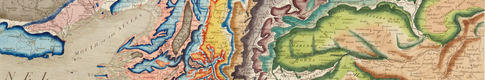

# (PART\*) Practicals {.unnumbered}

# Introduction to QGIS {#intro_to_qgis}

## Introduction

### Aims {.unnumbered}

The aims of this practical are to:

1. Gain experience with the QGIS interface.
2. Become familiar with common spatial data types. 
3. Develop understanding of map production.  

### Application {.unnumbered}

To achieve this, we'll load, investigate and visualise spatial data for Manchester and make our first map with QGIS. 

### Data {.unnumbered}

All data for this weeks practical are available in `[data/manchester]` and include:

- Buildings and canals from the Ordnance Survey MasterMap Topography Layer [[Source](https://www.ordnancesurvey.co.uk/products/os-mastermap-topography-layer)]
- Roads from the Ordnance Survey Open Roads dataset [[Source](https://www.ordnancesurvey.co.uk/products/os-open-roads)]
- Trees from the Bluesky National Tree Map™ [[Source](https://bluesky-world.com/ntm/)]
- Rivers from OpenStreetMap [[Source](https://www.openstreetmap.org/)] 

------------------------------------------------------------------------

## Practical

### Data 

To begin the unit:

> Download the `GEOG10282` data pack from Canvas [here](). Right click &rarr; Extract All and save to a suitable location on your **P Drive**.

The directory structure is as follows:

- `data`: containing the data required for the unit. 
- `projects`: an empty directory for storing QGIS project files.
- `processing`: an empty directory for storing data you produce during the unit.
- `maps`: an empty directory for storing output maps. 

::: note
You should work on the P drive throughout this unit. Integration with cloud storage services (e.g., OneDrive) can cause problems, while you will have limited flexibility if working locally (C:). Don’t work on or save to C: apart from in exceptional circumstances - there is a risk your work will be lost. 

  

Alternatively you are welcome to use QGIS on a personal machine, and instructions for installing the software are provided [here](#download_qgis).
:::

### QGIS 

> Open QGIS. 

Introduce:

- Menu Bar
- Map View and Navigation
- Layers Panel

> Project &rarr; Save As &rarr; `P:/GEOG10282/projects/week_1.qgz`. 

### Points

Manual approach: 

> Layer &rarr; Add Layer &rarr; Add Vector Layer &rarr; Source &rarr; Vector Dataset(s) &rarr; [`data/manchester/trees.shp`]

Drag-and-drop: 

> Navigate to the `[data/manchester]` directory, select `trees.shp` (**not** `.cpg`, `.dbf`, `.prj`, or `.shx`), drag to the QGIS window, and release on the Map Window.

Remove one of the layers from the Layers Panel:

> Layers Panel &rarr; Right Click the layer &rarr; Remove Layer. 

To provide context: 

> Web &rarr; QuickMapServices &rarr; Google &rarr; Google Hybrid

Introduce layer hierarchy and visibility: 

> Layers Panel &rarr; Drag `trees` to the bottom, below `Google Hybrid`.

> Layers Panel &rarr; Uncheck the tick box for `trees`.

High-level introduction to **point** vector data. 

> Right click `trees` in the Layers Panel &rarr; Properties &rarr; Information

::: question
How many trees are there in this area of Manchester?
:::

> Right click `trees` in the Layers Panel &rarr; Open Attribute Table 

Introduce geometries and attributes (`height` is the maximum height of the tree in meters). 

::: question
What is the height of the tallest tree in this area?
:::

> Click the `height` column to sort in descending order.

::: question
Where is the tallest tree? 
:::

> Highlight the row in the Attribute Table with the maximum height &rarr; Zoom map to the selected rows.

::: question
How far away is the nearest tree to the main entrance of the Rutherford Building?
:::

> Pan the map to the Rutherford Building &rarr; Attributes Toolbar &rarr; Measure Line &rarr; Click on the entrance in the satellite basemap &rarr; Click on the nearest tree point $\approx16\;\text{m distance}$.

::: question
How tall is it? 
:::

> Attributes Toolbar &rarr; Identify Features &rarr; Click on the nearest tree point $\approx22.7\;\text{m height}$.

To modify our layer symbology:

> Right click &rarr; Properties &rarr; Symbology &rarr; Graduated &rarr; Value = `height` &rarr; Classify &rarr; Apply

> Color ramp &rarr; Greens

> Mode &rarr; Natural Breaks (Jenks) &rarr; Classes = `10` &rarr; Apply

### Lines

Using a manual or drag-and-drop approach:

> Add [`data/manchester/roads.shp`] to QGIS.

High-level introduction to **line** vector data. 

> Properties &rarr; Symbology &rarr; Categorized &rarr; Value = `class` &rarr; Apply. 

Move from random to a more meaningful symbology: 

> Symbology &rarr; Double click `A Road` symbol &rarr; Color = Green (`#159666`) &rarr; Width = 0.5 

> Symbology &rarr; Double click `Motorway` symbol &rarr; Color = Blue (`#1a9bfa`) &rarr; Width = 0.8

> Symbology &rarr; Select all other categories **except** *all other values* &rarr; Delete

> Symbology &rarr; Double click `all other values` symbol &rarr; Color = Grey (`#c5c5c5`) &rarr; Width = 0.2

### Polygons

Using a manual or drag-and-drop approach:

> Add the following datasets to QGIS: [`buildings.shp`, `river.shp`, `canals.shp`]

High-level introduction to **polygon** vector data. 

Unlike line data, with polygons (and points) we can edit both the fill color and the stroke (edge) color.

> Properties of the `buildings` layer &rarr; Symbology &rarr; Simple Fill &rarr; Fill Color = Grey (`#d2d2d2`) &rarr; Stroke Color = Black (#000000) or click the Down arrow &rarr; Transparent Stroke

> Using the skills you've developed so far, modifying the symbology of the `river` and `canals` layers. 

### Map production

> Project &rarr; New Print Layout &rarr; Enter a name e.g., `Week_1_map`.

QGIS is arguably the best software for map production, and there is lots of functionality in here that we won't be able to cover in detail. 

We'll focus on some of the key elements of most maps - adding a legend, north arrow, and scale bar.

> Add Item &rarr; Add Map

> Select/Move Item to resize the map frame

> Move Item Content to set the size and position of content within the map frame. Use the mouse wheel to rescale the map or set this manually in Item Properties &rarr; Main Properties &rarr; Scale, and pan the map to your desired location e.g., the University campus.

Back in the main QGIS window:

> Decide which layers you want to include or exclude from your output map, by checking or unchecking these in the Layers Panel. 

> Think carefully about layer hierarchy. 

> Typically we would not use the QuickMapServices base imagery. 

> Add Item &rarr; Add Scale Bar

> Add Item &rarr; Add Legend

> Add Item &rarr; Add North Arrow

> Add Item &rarr; Add Label (title)

### Map export

> Layout &rarr; Export as Image &rarr; [`GEOG10282/maps/week_1_map.png`] &rarr; Save. Export resolution = `300 dpi`. Crop to Content = Checked &rarr; Save. 

**Congratulations!** You have completed the practical and should now be familiar with QGIS, important types of spatial data, and have produced your first map. 

[Finished!](#index)

## Extra {#download_qgis}

For those of you who would prefer to work on a personal machine:

> Instructions for installing QGIS. 

## Resources

- Devillers, R., and Jeansoulin, R. ([2006](https://doi.org/10.1002/9780470612156.ch2)) Spatial Data Quality: Concepts, in Devillers, R., and Jeansoulin, R. (eds) *Fundamentals of Spatial Data Quality*. 

