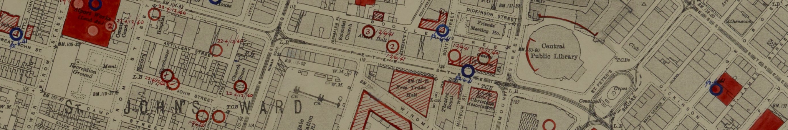

# Georeferencing {#georeferencing}

## Introduction



### Aims {.unnumbered}

The aims of this practical are to:

1. Aim A
2. Aim B
3. Aim C

### Application {.unnumbered}

To achieve this, we'll ...

### Data {.unnumbered}

-   WorldClim temperature and precipitation data, available in [`data/world-clim`] [[Source](https://www.worldclim.org/data/index.html)]

### Tools {.unnumbered}

[Zonal Statistics as Table](https://doc.esri.com/en/arcgis-pro/latest/tool-reference/spatial-analyst/zonal-statistics-as-table.html?tabs=dialog) (Spatial Analyst)

------------------------------------------------------------------------

## Practical

> Download `GB127.MISC_1192_1_017.jpg` from the University Map Library [here](https://luna.manchester.ac.uk/luna/servlet/s/yt01u4). 

> Open Web &rarr; QuickMapServices &rarr; Google Hybrid. Zoom and pan the map to Manchester.

> Project &rarr; Properties &rarr; CRS. Under "Filter", search for `27700` and then select EPSG:27700 - OSGB36 / British National Grid, and then press **Apply**. Alternatively, this can be found via Predefined Coordinate Reference Systems &rarr; Projected &rarr; Transverse Mercator &rarr; OSGB36 / British National Grid (EPSG:27700)

If successful, EPSG:27700 should now be listed in the Status Bar. 

> Open Layer &rarr; Georeferencer

> File &rarr; Open Raster

When georeferencing, we are assigning geographic coordinates to the features visible in the historic map. 

::: question
What can you spot on the historic map that is still present today, and would therefore be visible on modern satellite imagery?  
:::

e.g., prominent buildings, canals, parks can be useful examples. 

> Press `Add Point` and then select a suitablity distinct feature in the historic map (provide example).

> On the `Enter Map Coordinates` window, you have the option to enter XY or East-North coordinates manually, if for example if you knew the coordinates of something in advance. A more common approach would be select coordinates using the Map Canvas. 

::: note 
Provide them with some coordinates for a distinctive place? Probably not... 
:::

> Select `From Map Canvas` and then pan and scale the map to find the corresponding location in the Google Satellite imagery (example here). 

If successful, this should load the point to the `GCP table` (ground control points) in the Georeferencer. 

> Add more ground control points to the map. You should aim to add **at least seven** gcps, spread out across the map canvas, including near to all four corners. Increasing the number of (high-quality) gcps will improve the quality of your georeferencing. 

Once you have mapped three points, the `GCP table` and Georeferencer should update to include Residual (pixels). 

To georeference:

> Open Settings &rarr; Transformation Settings, set "Transformation Type" as `Linear`, choose an output file name e.g., `GB127.MISC_1192_1_017_27700.tif` and choose "Resampling Method" as `Nearest Neighbour`.

::: note 
Review the transformation performance. 
:::

The other methods are increasingly complex, and involve ... In general, we want to select the simplest transformation possible, while achieving the required georeferencing accuracy. 

> When complete, use the Play button to `Start Georeferencing`. The georeference image (.`tif`) should now be visible in the Layers Panel. 

> Change the opacity. Right click &rarr; Properties &rarr; Transparency. 

::: question
Which parts of Manchester have changed since 1940? 
:::

::: note
To discuss:

- High-level introduction to Coordinate Reference Systems
- British National Grid
- Assigning coordinates
- Different transformations (high-0level)
:::
  
Alternatives: GB127.MISC_1192_1_014, GB127.MISC_1192_1_015, GB127.MISC_1192_1_018

## Resources

- Devillers, R., and Jeansoulin, R. ([2006](https://doi.org/10.1002/9780470612156.ch2)) Spatial Data Quality: Concepts, in Devillers, R., and Jeansoulin, R. (eds) *Fundamentals of Spatial Data Quality*. 

```{r, eval=FALSE, echo=FALSE}

# Directory containing the zipped image files and metadata
zip_dir <- "../../ww2_maps"

# Output directories
image_dir <- file.path(zip_dir, "images")
text_dir  <- file.path(zip_dir, "meta")

# Create output directories if they don't exist
dir.create(image_dir, showWarnings = FALSE)
dir.create(text_dir, showWarnings = FALSE)

# Find all zip files
zip_files <- list.files(
  zip_dir,
  pattern = "\\.zip$",
  full.names = TRUE,
  ignore.case = TRUE
)

# Process each zip file
for (zip_file in zip_files) {

  # Extract to a temporary directory
  temp_dir <- tempfile()
  dir.create(temp_dir)

  # Unzip
  unzip(zip_file, exdir = temp_dir)

  # Find JPG and text files, including in subdirectories
  files <- list.files(
    temp_dir,
    recursive = TRUE,
    full.names = TRUE
  )

  # Identify image and text files
  jpg_files <- files[grepl("\\.jpe?g$", files, ignore.case = TRUE)]
  txt_files <- files[grepl("\\.txt$", files, ignore.case = TRUE)]

  # Copy images and text files to their respective directories
  file.copy(jpg_files, image_dir, overwrite = TRUE)
  file.copy(txt_files, text_dir, overwrite = TRUE)

  # Remove temporary extracted files
  unlink(temp_dir, recursive = TRUE)
}

```
