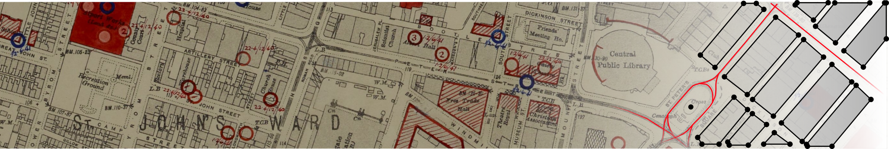

# Digitising {#digitising}

## Introduction

### Aims {.unnumbered}

The aims of this practical are to:

1. Aim A
2. Aim B
3. Aim C

### Application {.unnumbered}

To achieve this, we'll ...

### Data {.unnumbered}

-   WorldClim temperature and precipitation data, available in [`data/world-clim`] [[Source](https://www.worldclim.org/data/index.html)]

### Tools {.unnumbered}

[Zonal Statistics as Table](https://doc.esri.com/en/arcgis-pro/latest/tool-reference/spatial-analyst/zonal-statistics-as-table.html?tabs=dialog) (Spatial Analyst)

------------------------------------------------------------------------

## Practical

### Layer Creation

> Open your QGIS project and load the georeferenced map from Practical 2. 

> Layer &rarr; Create Layer &rarr; New Shapefile Layer. Choose a file name and location (`practical_2/bomb_locations.shp`), geometry type (`MultiPoint`) and choose the Project CRS (27700).

> Under New Field, we'll create a new field with "Name" as `Category`. Keep "Type" as `Text (String)` and then click "Add to Fields List"

> Again under New Field, create a new field with "Name" as `Date` and set to "Type" to `Date` and "Add to Fields List". To finish press "Ok". 

This new layer should now be visible in the Layers Panel. 

> Right click &rarr; Open Attribute Table we can see columns for storing the fields (attributes) we created earlier. 

At the moment, we have created our layer, which is stored as a shapefile (`.shp`) in our `practical_2` directory. However, there are currently no features present - we haven't mapped anything yet!

Before we do that, we'll repeat the above process to create a **polygon** layer for storing buildings damaged or destroyed during the bombing. 

> Layer &rarr; Create Layer &rarr; New Shapefile Layer. Choose a file name and location (`practical_2/damaged_buildings.shp`), geometry type (`Polygon`) and choose the Project CRS (27700).

As with the bomb locations, there are multiple categories for the mapping buildings, including damaged buildings (pink shading) and demolished buildings (red shading). 

::: note
Give examples here...
:::

> Under New Field, we'll create a new field with "Name" as `Category`. Keep "Type" as `Text (String)` and then click "Add to Fields List". 

Some of the damaged buildings have dates associated with them, but most don't, so we don't store a date field for this layer. 

### Point Digitising

> View &rarr; Toolbars &rarr; Digitizing Toolbar, which should resemble the following: 

> With the `bomb_locations` layer selected in the Layers Panel, select Toggle Editing. When this is toggled we can create new features, editing the geometry of existing features, add or remove attributes, and even delete features. 

> Next select "Add Point Feature" and click the map on a single bomb location. You should now be prompted to add Feature Attributes. For my example, the "Category" is `fire bombs` (red circle,  blue circles for `high explosives`) and the "Date" is the 22nd December 1940. 

Your mapped point should now be visible in the Map View, and the Attribute Table of `bomb_locations`. 

To ensure this is saved, you can use `Save Layer Edits`. Alternatively, if you toggle editing, you will be prompted to either save or discard any changes you have made. Be careful! 

> Repeat the above process to map all the individual bomb locations (as points), taking care to record the category (fire bombs, high explosives) and Date. 

::: question
How many bombs were dropped in our map area?
:::

::: question
Which areas were extensively bombed? Can you think why this might be?
:::

### Polygon Digitising

> With the `damaged_buildings` layer selected in the Layers Panel, select Toggle Editing. When this is toggled we can create new features, editing the geometry of existing features, add or remove attributes, and even delete features. 

> Next select "Add Polygon Feature" and click the map on the boundary of a damaged or demolished building. Continue clicking around the boundary, following the vertices of the boundary. 

> When you are happy with your digitised shape, right click to complete the shape and add the relevant category when prompted (damaged, destroyed). 

> Save your edits. If you wish to edit your shape, select the Vertex Tool on the Digitizing Toolbar. Select the vertex (point) you want to move, and then click again on the desired new location...

::: note
snapping settings
:::

> View &rarr; Toolbars &rarr; Snapping Toolbar

> Repeat the above process to map all the buildings (as polygons), taking care to record the category (damaged, destroyed). 

## Resources

- Devillers, R., and Jeansoulin, R. ([2006](https://doi.org/10.1002/9780470612156.ch2)) Spatial Data Quality: Concepts, in Devillers, R., and Jeansoulin, R. (eds) *Fundamentals of Spatial Data Quality*. 
