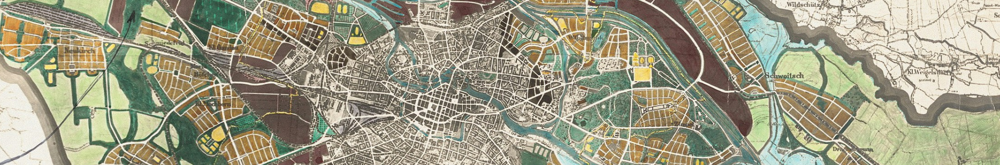

# Data Sourcing {#data-sources}

## Introduction

### Aims {.unnumbered}

The aims of this practical are to:

1. Aim A
2. Aim B
3. Aim C

### Application {.unnumbered}

To achieve this, we'll ...

### Data {.unnumbered}

-   WorldClim temperature and precipitation data, available in [`data/world-clim`] [[Source](https://www.worldclim.org/data/index.html)]

### Tools {.unnumbered}

[Zonal Statistics as Table](https://doc.esri.com/en/arcgis-pro/latest/tool-reference/spatial-analyst/zonal-statistics-as-table.html?tabs=dialog) (Spatial Analyst)

------------------------------------------------------------------------

## Practical

### Data

Download a range of layers from Digimap, for a particular area (information provided):

- Environment
- Land Cover
- Topography (brief mention of raster data, terrain + hydrological applications)
- Geology

What information do the layers provide?

## Resources

- Devillers, R., and Jeansoulin, R. ([2006](https://doi.org/10.1002/9780470612156.ch2)) Spatial Data Quality: Concepts, in Devillers, R., and Jeansoulin, R. (eds) *Fundamentals of Spatial Data Quality*. 
