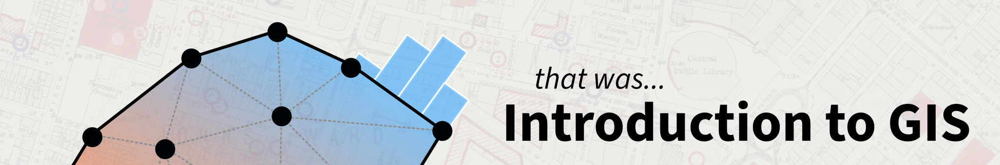

# (PART\*) Endmatter {-}

# Summary {#summary .unnumbered}

## Closing remarks {#closing .unnumbered}

*Introduction to GIS* is over! After 12 weeks of learning and effort, I hope that you are:

- **excited** about continuing your GIS journey in future academic years. 

- **aware** of the many possibilities of GIS, and the range of applications across both Physical *and* Human Geography. 

- have the **ability** to perform some introductory but powerful spatial queries and analyses. 

- can produce **high quality** maps and visualisations. 

## Acknowledgements {.unnumbered}

The development of *Introduction to GIS* has benefited from discussions with [Jonny Huck](https://research.manchester.ac.uk/en/persons/jonathan.huck/) and [Sarah Lindley](https://research.manchester.ac.uk/en/persons/sarah.lindley/), testing by [James Tomlinson](https://research.manchester.ac.uk/en/persons/james-tomlinson-2/) and [Sneha Mendiratta](https://research.manchester.ac.uk/en/persons/sneha.mendiratta) 
and wider support from the [Mapping, Computing and Geographical Information Science](https://www.humanities.manchester.ac.uk/geography/research/groups/mapping-computing-geographical-information-science/) research group.

I hope that *Introduction to GIS* has inspired you to explore GIS further, and if so, I'd recommend continuing your GIS journey with [**Spatial Thinking with GIS**]() in Year 2 and [**Understanding GIS**]() in Year 3, and delving into the wider literature included in the [reference list](#references). We also offer an [MSc in Geographic Information Science](https://www.manchester.ac.uk/study/masters/courses/list/07053/msc-geographical-information-science/), which is an excellent preparation for a career in research or industry.

Enjoy!

*Matt*
