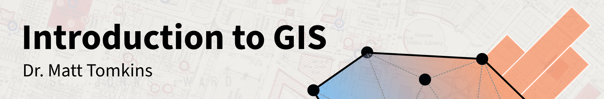

---
# Some bs4_book() and some gitbook() functionality here, not all works! 
title: Introduction to GIS
author: Matt Tomkins
site: bookdown::bookdown_site
documentclass: book
bibliography: intro-gis-resources.bib
csl: harvard-cite-them-right.csl
link-citations: true
header-includes:
  - \usepackage[dvipsnames]{xcolor}
output:
  bookdown::bs4_book: 
    css: style.css
    # toc_depth: 3
    theme:
      primary: "#0369a1"
      base_font:
        google:
          family: Source Sans Pro
          wght: [400, 600]
          ital: [0, 1]
      heading_font:
        google:
          family: Source Sans Pro
          wght: 600
      code_font:
        google:
          family: Fira Mono
          wght: [400, 600]
          local: false
    config:
      toc:
        collapse: section
        before: |
          <div style="text-align: center; margin: 1em 0;">
            
          </div>
      sharing: null
      fontsettings: 
        family: sans
---

# (PART\*) Home {-}

# Introduction to GIS {#index .unnumbered}

## Preface {#practical-aims .unnumbered}



*Introduction to GIS* will introduce you to the principles and methods of Geographic Information **Science** and provide practical and transferable skills in the use of Geographic Information **Systems**. You will explore applications across Physical and Human Geography and understand the potential of GIS to study and solve complex real-world problems. By the end of the unit you will be able to source, visualise, and analyse spatial data and will be equipped to pursue GIS further in Year 2 (*Spatial Thinking with GIS*) and Year 3 (*Understanding GIS*), and beyond ([*MSc in Geographical Information Science*](https://www.manchester.ac.uk/study/masters/courses/list/07053/msc-geographical-information-science/)). 

```{r, eval = TRUE, echo = FALSE, warning = FALSE, message = FALSE, results='hide'}

# Clean the previous bookdown version

# Function to check and install packages
check.packages <- function(pkg){
  new.pkg <- pkg[!(pkg %in% installed.packages()[, "Package"])]
  if (length(new.pkg))
    install.packages(new.pkg, dependencies = TRUE, repos = "http://cran.us.r-project.org")
  sapply(pkg, require, character.only = TRUE)
}

# Checks and installs packages
packages <- c("bookdown", "markdown", "pagedown")
check.packages(packages)

# Clean the docs folder
clean_book(clean = getOption("bookdown.clean_book", TRUE))

# Code to render
# bookdown::render_book("index.Rmd", "bookdown::gitbook", output_dir = "docs")
# bookdown::render_book("index.Rmd", "bookdown::bs4_book", output_dir = "docs")

# Can use bs4_book() format, but need to remove 'toc_depth' argument, and renamed to {#index .unnumbered}

# use {.hidden-section} to hide content from html file

```

In *Introduction to GIS*, you will:

- gain experience with QGIS, an open-source Geographic Information System: [Introduction to QGIS](#intro_to_qgis)
- create, source, and manage spatial data: [Georeferencing](#georeferencing), [Digitising](#digitising), [Participatory GIS](#participatory), [Data Sourcing](#data-sources), 
- analyse and visualise spatial data: [Spatial Queries](#querying), [Visualisation](#visualisation), [Mapping Tranquility I](#tranquil-1) and [II](#tranquil-2)

*Chapter links will become available as the unit progresses.*

## Guidance {.unnumbered}

As you progress through the following practicals, **instructions** will be formatted as follows:

> This is an instruction. 

You will see the following formatting for **questions** or as a prompt for **reflection**:

<div class="question"> 
This is a question. 
</div>

The following formatting is used to emphasise **key points**, provide additional information, or for quotations:

<div class="note"> 
This is a note. 
</div>

Each practical begins with an overview of the aims, application, data and tools, before introducing the **key concepts** for that week.    
